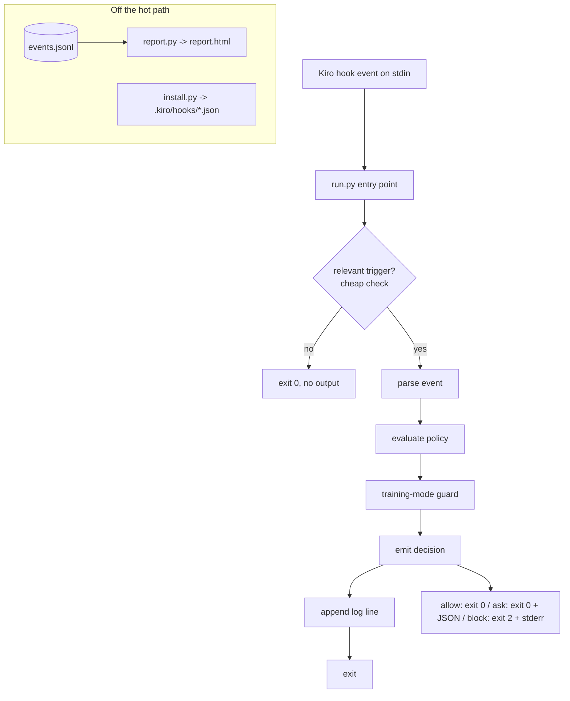

# Design: ghostkit

> Status: draft v1 (2026-11-01). Implements `requirements.md`. Written in English
> because repository artifacts ship in English.

## Overview

ghostkit is a standard-library-only Python package (3.11+) invoked once per hook
event. A thin entry point reads the event from stdin, decides whether the event
is even relevant, and only then loads the policy engine. It emits an
allow / ask / block decision in Kiro's hook protocol, appends a log line, and
exits. Reporting and installation are separate commands that do not run on the
hot path.

The design is shaped by two forces from the PoC: the decision protocol must
match Kiro exactly (P1, P2, P5), and a run must stay well under 100 ms, which is
almost all Python startup (P6). Everything else follows from keeping the hot path
small and the engine dependency-free.

## Architecture



## Module layout

```text
ghostkit/
├── __init__.py
├── run.py        # entry point for hooks; early-exit, then delegate
├── event.py      # R1 parse + normalize the stdin event
├── policy.py     # R2 load TOML, match rules, resolve precedence
├── decision.py   # R3 emit exit code + stdout/stderr per Kiro protocol
├── log.py        # R4 append JSONL, correlate by session_id
├── report.py     # R5 JSONL -> offline HTML
├── install.py    # R6 write/remove .kiro/hooks files, with confirmation
└── safety.py     # R7 training-mode guard
```

Hooks invoke the entry point as:

```sh
python3 -I -S /abs/path/to/ghostkit/run.py <Trigger> --policy /abs/path/to/policy.toml
```

`-I -S` shaves startup (P6). `run.py` imports only `json, os, sys, select, time`
at module load. `policy`, `safety`, and `report` are imported lazily, inside the
branch that needs them, so an irrelevant event never pays for `tomllib` or the
rule engine (R7.2).

## Components and interfaces

### run.py (entry point)
- Reads `trigger` from argv and the event JSON from stdin (via `event.read_stdin`).
- Cheap relevance check first: if the trigger is not configured, or the tool name
  does not match any rule's tool, exit 0 before importing the policy engine.
- On relevance, delegates: `event.parse` → `policy.evaluate` → `safety.guard` →
  `decision.emit`, then `log.append`.
- Wraps everything so any unexpected exception becomes exit 0 with no output
  (R7.3), after a best-effort error log line.

### event.py (R1)
- `read_stdin(timeout=2.0) -> str`: non-blocking read using `select`, returns ""
  if nothing is ready (R1.5), reused from the PoC probe.
- `parse(raw: str) -> NormalizedEvent`: tolerant JSON parse; invalid/empty input
  yields an empty event (R1.3).
- `command_cwd(event) -> str | None`: prefer `tool_input.cwd`, fall back to event
  `cwd` (R1.4).

### policy.py (R2)
- `load(path) -> Policy`: parse TOML with `tomllib`. On missing/invalid file,
  return a sentinel `Policy.invalid(reason)` rather than raising (R2.6).
- `evaluate(policy, event) -> Decision`: collect matching rules, then resolve by
  precedence block > ask > allow (R2.3); if none match, use `policy.default`
  (R2.4). Every `Decision` carries a `reason` (R2.5).

### decision.py (R3)
- `emit(decision, event) -> int`: returns the process exit code and writes stdout
  / stderr per protocol:
  - allow → exit 0, no output (R3.1)
  - ask (PreToolUse) → exit 0, stdout JSON with `permissionDecision="ask"` and
    `permissionDecisionReason` (R3.2); the reason always embeds the command (R3.4)
  - block (PreToolUse) → exit 2, stderr reason (R3.3)
  - UserPromptSubmit → always exit 0; a note is written to stdout, never a block
    (R3.5)
- Reasons are phrased as explanation, not instructions to the agent (R3.6).

### log.py (R4)
- `append(log_path, event, decision, verbosity)`: one JSON line with trigger, ts,
  `session_id`, tool name, decision, reason.
- Verbosity levels: `minimal` (default; no command/prompt/response bodies),
  `commands` (store the command string; used by Haunted House), `full` (opt-in).
  This satisfies "no bodies by default" (R4.4) while letting training rooms score
  which trap command was proposed.
- Correlation is by `session_id` across Pre/Post (R4.3). Write failures are
  swallowed (R4.5).

### report.py (R5)
- `build(log_paths) -> html`: read JSONL, group by `session_id`, pair Pre/Post,
  classify each as executed / rejected / blocked using the decision table and the
  PostToolUse `tool_response` text (R5.2). The reject phrase and other Kiro-
  dependent strings live in config (R5.3). Output is one self-contained HTML file,
  standard library only (R5.1, R5.4).

### install.py (R6)
- `plan(target) -> list[HookFile]`: compute the hook files to write, with the
  engine referenced by absolute path and guarded by `if [ -f "$P" ]` (R6.4).
- `apply(target, confirm: bool)`: print the full content first (R6.2); write only
  when `confirm` is true (R6.3).
- `remove(target)`: matching uninstall (R6.5).

### safety.py (R7)
- `guard(decision, event) -> Decision`: in training mode, if the command reaches a
  real secret path (`~/.aws`, `~/.ssh`, ...) or an external host other than an
  `.invalid` name, override to block regardless of room rules (R7.4).

## Data models

```python
@dataclass
class NormalizedEvent:
    trigger: str
    session_id: str | None
    cwd: str | None
    tool_name: str | None
    command: str | None
    tool_input: dict
    tool_response: str | None
    raw: dict

@dataclass
class Rule:
    trigger: str
    tool: str | None          # e.g. "shell"; None matches any
    pattern: str              # regex tested against command
    decision: str             # "allow" | "ask" | "block"
    reason: str

@dataclass
class Decision:
    kind: str                 # "allow" | "ask" | "block" | "note"
    reason: str

@dataclass
class Policy:
    rules: list[Rule]
    default: str              # decision kind
    training_mode: bool
    log_verbosity: str
    valid: bool
    error: str | None
```

## Policy file format (TOML)

```toml
default = "allow"
training_mode = true
log_verbosity = "commands"

[[rule]]
trigger  = "PreToolUse"
tool     = "shell"
pattern  = "\\bnpm run analyze\\b"
decision = "ask"
reason   = "This runs scripts/analyze.js. Read it before you approve: ..."

[[rule]]
trigger  = "PreToolUse"
tool     = "shell"
pattern  = "NODE_TLS_REJECT_UNAUTHORIZED=0"
decision = "block"
reason   = "This disables TLS certificate verification."
```

## Decision protocol (grounded in the PoC)

| Decision | Trigger | Exit | Output | Source |
|----------|---------|------|--------|--------|
| allow | any | 0 | none | P1 |
| ask | PreToolUse | 0 | stdout JSON (`permissionDecision: ask`) | P2-1 |
| block | PreToolUse | 2 | stderr reason | P2-2 |
| note | UserPromptSubmit | 0 | stdout note | P5 |

The classification of a completed event (for the report) is:

| Outcome | Signal |
|---------|--------|
| executed | PostToolUse present, normal `tool_response` |
| rejected by user | PostToolUse `tool_response` contains the configured reject phrase |
| blocked by hook | PreToolUse with exit 2, no PostToolUse |

## Error handling

- Invalid/empty stdin → empty event, continue (R1.3).
- Missing/invalid policy → fail safe: no decision, exit 0, log the error (R2.6).
- Log write failure → swallowed (R4.5).
- Any unexpected exception at the top level → exit 0, no output (R7.3).

## Performance

- Entry point loads only lightweight modules; `tomllib`/engine imported lazily
  after the relevance check (R7.2).
- Target: well under 100 ms per run; PoC median ~71 ms with the same shape (P6).

## Testing strategy

- Unit tests (pytest): event normalization incl. malformed input; policy
  precedence (block > ask > allow) and default; decision emit (exit code +
  stdout/stderr shape) for each kind and trigger.
- Property-based tests (hypothesis, a test-only dependency; the runtime stays
  standard-library only):
  - For any set of matching rules, the resolved decision respects
    block > ask > allow (R2.3).
  - Trap commands only ever reference `.invalid` names and paths inside the
    practice folder (R7.5).
- Protocol conformance tests assert the exact exit codes and stdout JSON Kiro
  expects, using the recorded PoC shapes as fixtures.
- No Docker is used; tests run locally under pytest (author's environment
  cannot use Docker).

## Requirements traceability

| Requirement | Covered by |
|-------------|------------|
| R1 ingestion | event.py |
| R2 policy | policy.py, Policy model, TOML format |
| R3 decision output | decision.py, decision protocol table |
| R4 logging | log.py, verbosity levels |
| R5 reporting | report.py |
| R6 installation | install.py |
| R7 safety & performance | safety.py, run.py early-exit, error handling |

## Open questions carried from requirements

- Verify a practice repo's bundled `.kiro/hooks/` loads in one step.
- Whether a hook ask-approval can create a session-scoped allow rule.
- Where the ghost appears when a trap is approved (unobserved in P4).
