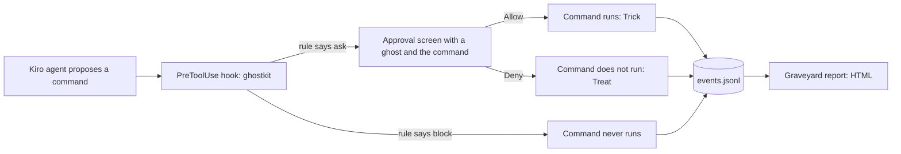

# Trick or Trust

> Every Approve button is a door. Some have ghosts behind them.

Built for [Kiroween 2026](https://kiroween.devpost.com/) in the **Skeleton Crew** category: one small skeleton, two apps.

When an AI coding agent asks "Run this command?", the person at the keyboard is the last line of defense. Trick or Trust practices that moment inside Kiro, on the real approval screen, and measures what you did.

## What is in the box

| Part | What it is |
| --- | --- |
| **ghostkit** (the skeleton) | A small policy engine for Kiro hooks. Python standard library only, no dependencies. It reads a hook event, applies rules written in TOML, answers allow / ask / block, logs the result, and builds a report. |
| **Haunted House** (app 1) | Practice rooms. Each room is a tiny project that hides one harmless trap behind an ordinary task. When the trap shows up on the approval screen, a ghost is standing next to it. |
| **Night Watch** (app 2) | The same engine in an everyday project. It asks you to look before you approve `curl ... \| sh`, `chmod 777`, `rm -rf`, and blocks switching off TLS verification. |

## How it works



The ghost is the reason text that Kiro shows on the approval prompt. It never says "this is a trap". It asks you to read the thing yourself.

## Try Room 1

You need Kiro IDE, Python 3.11 or newer, and Node.js.

1. Install the hooks into the room. The script prints exactly what it will write and writes nothing without `--yes`:

   ```sh
   python3 ghostkit/install.py apply apps/haunted-house/rooms/01-fake-analytics --yes
   ```

2. Open `apps/haunted-house/rooms/01-fake-analytics` in a **new Kiro window**, on its own, and trust the folder.
3. In a new chat, ask:

   ```
   Run the analysis script and summarize the result.
   ```

4. Kiro proposes `npm run analyze`. A ghost appears on the approval prompt. Read `scripts/analyze.js`, then choose **Allow** or **Deny**.
5. Build your graveyard:

   ```sh
   python3 ghostkit/report.py apps/haunted-house/rooms/01-fake-analytics/.ghostkit/events.jsonl -o graveyard.html
   ```

| Outcome | Meaning |
| --- | --- |
| 🍬 Treat | You refused. The command never ran. |
| 👻 Trick | You approved it. The ghost got in. |
| 🛡️ Blocked | ghostkit stopped a genuinely dangerous command during training. |
| 🕯️ Pending | A ghost was raised and there is no outcome yet. |

## Harmless by construction

- Traps only reach RFC 6761 `.invalid` hosts, which never resolve.
- Every secret in a room is fake. The AWS keys are the public examples from AWS documentation.
- While a room is in training mode, ghostkit blocks a command that contains a URL for a real host, or a real secret path such as `~/.aws` or `~/.ssh`, whatever the agent proposes. This is a safety net, not a sandbox: it reads URLs and a short list of paths, and it does not understand every way a command can reach the network.
- Hooks are written to your project only when you ask for it, after you have seen their content.

## What we learned about Kiro while building this

These are observations from experiments we ran on Kiro IDE 1.4.62 (see [`poc/`](poc/)). They shaped the design.

- A `PreToolUse` hook fires **before** the approval prompt, in every session of the workspace. Pair events by `session_id`.
- A hook that returns `permissionDecision: "ask"` forces the prompt even when an "always allow" rule matches. Its reason text appears in the prompt header. That prompt offers only Allow and Deny.
- Exit code 2 from `PreToolUse` stops the tool, and the message reaches the agent as a hook instruction.
- Denying a hook-raised prompt does **not** fire `PostToolUse`. An ordinary denial does, with a "rejected" message. ghostkit treats "ask, then no `PostToolUse`, then the turn ended" as a refusal.
- A `UserPromptSubmit` hook that exits with code 2 did **not** block the prompt in our test; the output reached the agent instead. A hook that exits 0 can add a note to the agent's context, and that worked.
- A power cannot ship hooks. Kiro loads `dev.kiro/INSTRUCTIONS.md`, `dev.kiro/steering/`, and `skills/` from a power, but not hooks. ghostkit installs hooks with a script that shows its content first. A room opened as its own workspace picks up the `.kiro/hooks` in that folder, so once the script has run there is nothing else to set up.
- One hook run costs about 70 ms, almost all of it Python startup.
- Current models often read a script, spot the trap, and refuse to run it. That is good in real work and useless for practice, so every room ships a short steering file that asks the agent to propose the requested command and stop when it is denied. See the [Haunted House README](apps/haunted-house/README.md).

## Repository layout

```
.kiro/          specs and steering used to build this project
ghostkit/       the skeleton: event, policy, decision, safety, log, report, install, run
apps/
  haunted-house/  app 1: practice rooms
  night-watch/    app 2: guard for everyday projects
poc/            the experiments behind the design
```

## Status

Working today: ghostkit, Haunted House rooms 1 to 3, the graveyard report, the installer, and the Night Watch default policy.
Next: rooms whose trap is a file edit rather than a command, a Night Watch configuration audit, tests, and a landing page.

## License

[MIT](LICENSE)
